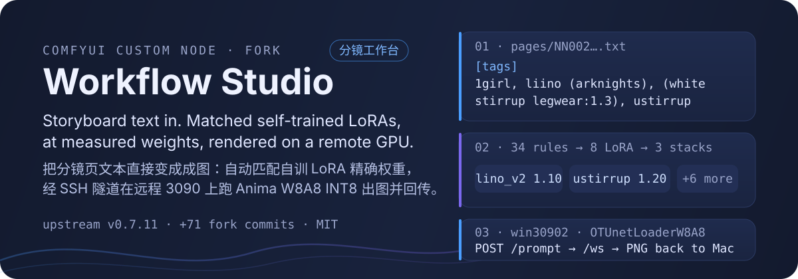
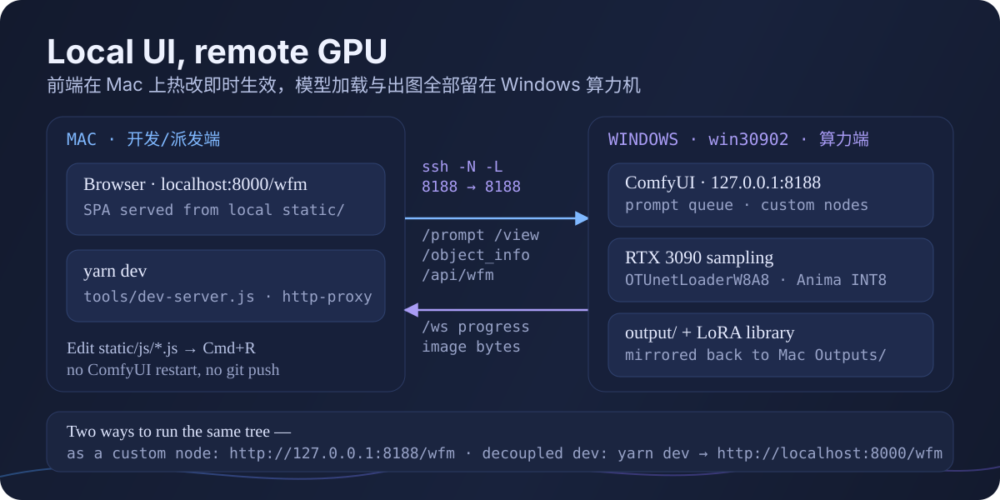
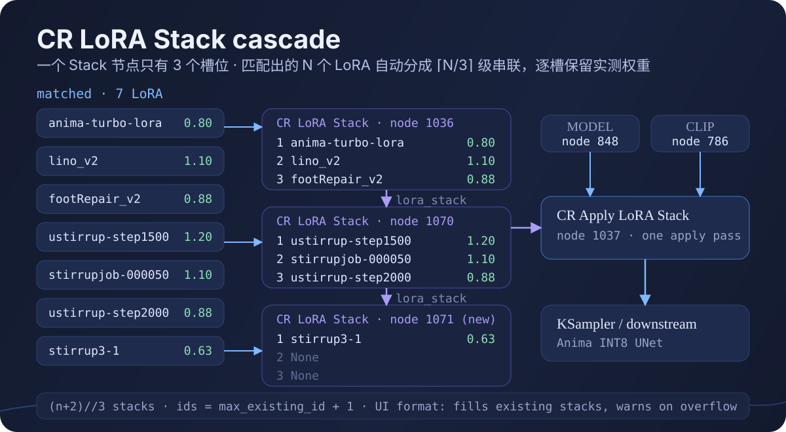

<p align="center">
  
</p>

<p align="center">
  <a href="https://github.com/comfyanonymous/ComfyUI"></a>
  <a href="https://github.com/ketle-man/ComfyUI-Workflow-Studio"></a>
  
  <a href="./LICENSE"></a>
</p>

A **fork** of [ketle-man/ComfyUI-Workflow-Studio](https://github.com/ketle-man/ComfyUI-Workflow-Studio) — the ComfyUI workflow / asset / generation studio, plus the pipeline this fork exists for: **storyboard page in → matched self-trained LoRAs at measured weights → rendered on a remote GPU → images back on the local disk.**

本仓库是 [ketle-man/ComfyUI-Workflow-Studio](https://github.com/ketle-man/ComfyUI-Workflow-Studio) 的 **fork**。上游那套 Studio 全部保留；这个 fork 存在的理由是上面那条链路：分镜页文本进 → 自动匹配自训 LoRA 的实测权重 → 远程算力机出图 → 图回传本机。

---

## What this fork adds · 本 fork 加了什么

| Capability | 一句话 | Where |
| --- | --- | --- |
| **Decoupled dev server** | 前端在 Mac 上热改，算力留在远程机 | `tools/dev-server.js` |
| **Storyboard parsing** | `[tags]` / `[caption]` 分镜页 → 结构化提示词 | `py/services/lora_trigger_service.py` |
| **LoRA trigger rules** | 34 条自训 LoRA 规则库（角色/画师/动作/画质） | `data/lora_rules.json` |
| **CR LoRA Stack cascade** | 超过 3 个 LoRA 自动分块串联，逐槽保留权重 | `py/services/lora_trigger_service.py` |
| **Generation presets** | 步数 / CFG / 采样器 / 调度器 / denoise / LoRA 一键装配 | `py/services/gen_presets_service.py`, `data/gen_presets.json` |
| **Artists tab** | 画师 LoRA 浏览，并把选择写进 `batch.toml` | `py/services/artist_service.py`, `static/js/artists-tab.js` |
| **Anima W8A8 INT8** | 认得 `OTUnetLoaderW8A8`，不再当成缺 checkpoint | `py/services/workflow_analyzer.py`, `static/js/comfyui-workflow.js` |
| **`batch.toml` engine** | 一个作品的整批分镜出图，配置全在 TOML 里 | `tools/story_config.py`, `tools/run_typhon_batch.py` |
| **New UI track** | React 19 + `@material/web` 的 M3 前端，与旧 SPA 并存 | `frontend/`, `static/js/core/` |

---

## Quick start · 快速上手

**Decoupled mode（日常开发路径 / 推荐）** — the Studio UI runs on your machine, ComfyUI runs wherever the GPU is:

```bash
ssh -N -L 8188:127.0.0.1:8188 win30902      # 或局域网直连，跳过这一步
yarn install
yarn dev                                     # :8000，默认代理 127.0.0.1:8188
open http://localhost:8000/wfm
```

Point it at another box without touching code:

```bash
yarn dev --port 8080 --comfy-url http://192.168.1.100:8188
```

**Custom-node mode** — clone into `ComfyUI/custom_nodes/`, `pip install -r requirements.txt`, restart ComfyUI, then click the **W** button (or open `http://127.0.0.1:8188/wfm`). 上游的 ComfyUI Manager 安装方式装到的是上游版本，不含本 fork 的任何东西。

---

## The pipeline · 出图链路

<p align="center">
  
</p>

- **Local / 本地**: `static/`, `templates/`, `data/` are read from the working copy, so a `.js` or `.css` edit lands on **Cmd+R** — no commit, no `git pull` on the render box, no 30–60 s ComfyUI restart.
- **Remote / 远程**: checkpoints, the quantized Anima UNet, the LoRA library and VRAM management stay on the GPU box.
- **Same origin / 同源透传**: `/prompt`, `/view`, `/object_info`, `/api/wfm/*` and the `/ws` upgrade are all proxied, so the browser never sees CORS and progress still streams.

---

## Storyboard → LoRA · 分镜解析与智能触发

A page is a plain text file under `pages/`, tags and natural-language caption in one file:

```text
[tags]
1girl, liino \(arknights\), blonde hair, (white stirrup legwear:1.3), stirrupjob, ustirrup, footjob

[caption]
Liino props one shoulder against the backstage hallway wall, tease smile with one eye closed...
[/caption]
```

1. **Split · 结构切分** — `[tags]` / `[caption]` are parsed out; if `[tags]` is missing, everything before `[caption]` is treated as positive tags.
2. **Match · 关键词检索** — aliases, underscores and escaped parentheses are normalised, so `liino`, `stirrupjob`, `@footrepair`, `cervical` all resolve.
3. **Rules first · 规则优先** — `data/lora_rules.json` holds **34** rules: 11 character, 9 artist, 8 action, 4 aesthetic, 1 repair, 1 clothes, each with its own `model_weight` / `clip_weight`.
4. **Redundancy off · 冗余步数抑制** — sibling checkpoints from the same training run (`-000051`, `-000081`, …) are rescan-marked `active: false` so they cannot dilute each other.

These are plugin routes on the Python side (`py/routes/lora_trigger_routes.py`), so in decoupled mode they travel through the proxy to ComfyUI — with the backend down the dev server answers 502.

```
POST /api/wfm/lora/match          # 文本 → 匹配出的 LoRA 列表
GET  /api/wfm/lora/rules          # 规则库
POST /api/wfm/lora/rules/rescan   # 扫模型目录重建规则
POST /api/wfm/lora/apply          # 写进工作流
```

UI 侧对应 Prompt 页的 **「故事分镜 & 智能 LoRA 混合」** 卡片（`static/js/prompt-story-lora.js`，支持批量导入 `LN*.txt`）。

---

## Cascade · 多 LoRA 精确权重级联

<p align="center">
  
</p>

`CR LoRA Stack` only holds three slots, so the service chunks the match list: **`(n + 2) // 3`** stacks, chained socket to socket, with each LoRA's own weights written into its slot.

The shipped `liino-footjob-suite` preset is the eight-LoRA case that motivated this:

| # | LoRA | model | clip |
| --- | --- | --- | --- |
| 1 | `anima-turbo-lora-v0.2` | 0.80 | 1.0 |
| 2 | `lino_v2` (character) | 1.10 | 1.0 |
| 3 | `anima_footRepair_v2` | 0.88 | 1.0 |
| 4 | `ustirrup-step00001500` | 1.20 | 1.0 |
| 5 | `stirrupjob-000050` | 1.10 | 1.0 |
| 6 | `ustirrup-step00002000` | 0.88 | 1.0 |
| 7 | `stirrup3-1` | 0.63 | 1.0 |
| 8 | `anima-highres-aesthetic-boost` | 0.48 | 1.0 |

- **API format** creates the extra stacks and ids them `max_existing_id + 1` (fallback `9000`) — existing wiring is never touched.
- **UI format** fills the stacks that already exist and **warns on overflow** instead of silently dropping a LoRA.
- 权重、开关、移除都在前端逐条微调：点【立即写入工作流】，或点 Generate 时静默应用。

---

## Generation presets · 生成预设

Six presets ship in `data/gen_presets.json`; applying one writes steps / CFG / sampler / scheduler / denoise / LoRA in a single call.

| id | mode | steps | cfg | sampler / scheduler |
| --- | --- | --- | --- | --- |
| `anima-single-turbo` | single | 12 | 1.6 | `euler_ancestral` / `beta57` |
| `anima-single-17` | single | 17 | 1.6 | `dpmpp_2m_sde_gpu` / `beta57` |
| `anima-single-17-jimaduo` | single | 17 | 1.6 | `dpmpp_2m_sde_gpu` / `beta57`, +2 画师 LoRA |
| `anima-native-30` | single | 30 | 4.0 | `er_sde` / `beta57`, no Turbo |
| `anima-two-stage-standard` | double | 5 + 17 | 4.6 / 1.6 | stage 2 `denoise 0.7` |
| `liino-footjob-suite` | single | 12 | 1.6 | the 8-LoRA suite above |

Two things the notes recorded inside that file are worth knowing:

- **Two-stage only exists if `denoise < 1.0`.** At `denoise = 1.0` stage 2 restarts from pure noise — measured RMSE 0 against simply skipping stage 1, while still paying 5 steps per image. The applier now writes denoise into all four slots.
- **`anima-single-17` is the batch default**, because a 3-seed comparison found the two-stage path produced more broken panels (floating white grid, bad proportions). 要更多分格再换回双层。

```bash
# /api/wfm/* 由插件的 Python 侧提供，需要后端在线
curl -s -X POST http://127.0.0.1:8000/api/wfm/gen_presets/apply \
     -H 'Content-Type: application/json' -d '{"id":"anima-single-17"}'
```

---

## Batch engine · `batch.toml` 批量出图

> **写一个 `batch.toml` → 建一个 3 行 runner → 干跑校验 → `wait_and_run.sh` 起 → 挂守望 + 回传。**

Everything about a story lives next to its pages, and every relative path resolves against the TOML's own directory, so the whole story folder stays portable:

```toml
[story]
id   = "qinliu"
name = "琴柳"

[paths]
pages_dir     = "pages"
page_glob     = "NN*.txt"          # 前缀必须统一且唯一
output_subdir = "琴柳"

[output]
mac_dir = "../../../../Outputs"    # 留空 = 不回传，图只留在算力机

[base]
preset = "anima-single-17"         # 引用 Studio 的 gen_presets.json
  [[base.loras]]
  name = "Turbo-v0.2"
```

```bash
tools/run_batch.sh run_qinliu_batch.py 1 --only NN022,NN023 --tag _v2   # 局部重跑 / 打版本
nohup tools/wait_and_run.sh run_qinliu_batch.py 1 > /tmp/qinliu.log 2>&1 &
```

`wait_and_run.sh` polls `GET /object_info/OTUnetLoaderW8A8` before starting, because a dropped model root makes `/prompt` return 400 for every page — waiting beats burning the batch. Per-story overrides live in `[runtime]`, `[validation]`, `[[page_rule]]`, `[[page_canvas]]` and `[incontext]`.

`tools/` holds the shared engine (`run_typhon_batch.py`), **17** per-story runners, **7** `probe_*.py` one-off experiments, and the gate scripts below. 正式出图只有 `batch.toml` 这一个入口，完整口径见 [docs/BATCH-DISPATCH.md](docs/BATCH-DISPATCH.md)。

---

## Development · 开发与上游同步

```bash
yarn test:core     # node --test tools/core-tests/
yarn build         # tsc --noEmit && vite build → static/newui
yarn check:newui   # 新 UI 产物门禁，含上游偏离闸 A1
yarn test:gates    # 跑 tools/test_*gate*.py 三个纯函数门禁，不需要 GPU 也不需要 ComfyUI
```

Staying mergeable with upstream is the real constraint here, so it is measured rather than asserted:

- `tools/upstream-baseline.txt` pins a git blob hash for each of the **192** tracked files the fork does not own, and gate **A1** in `tools/check-newui.sh` goes red on any drift.
- `tools/upstream-deviations.txt` lists the **only four** upstream-owned files this fork edits — two from the front-end port, plus `README.md` and `README.index.md` taken over by this homepage — each with the reason and the test that pins it.
- Everything the fork adds is **additive**: `git diff --diff-filter=D upstream/main...HEAD` is empty — 0 deletions across 199 paths and 73 commits as of the v0.7.11 sync — and upstream merges land on a `sync/upstream-*` branch, never on `main`.
- [MIGRATION-NOTES.md](MIGRATION-NOTES.md) is the authoritative record of where the implementation departs from the original brief, and why.

New UI is served at `http://localhost:8000/wfm_static/newui.html` while the classic SPA at `/wfm` stays the default.

---

## What you inherit · 你继承了什么

Everything upstream ships is intact: the Workflow / Models / Prompts / Gallery / Nodes / Metadata / Video / Lab / AI / Settings tabs, batch generation across models, samplers, prompts and workflows, the Image Feeder, canvas snapshots, CivitAI model browsing, the drag-&-drop library side panel, PSD and mask tooling, and the EN / JA / ZH interface.

| | |
| :---: | :---: |
|  |  |

Per-tab detail belongs to upstream and lives in [the upstream README](https://github.com/ketle-man/ComfyUI-Workflow-Studio#features) rather than being duplicated here.

---

## Requirements · 环境

- **Node ≥ 20.19** + Yarn — the dev server and the Vite / Material Web front end
- **Python 3.10+** for the plugin itself (`jinja2`, plus `requirements.txt`: `onnxruntime`, `piexif`, `python-dotenv`, `psd-tools`)
- **Python 3.11+** for the batch engine — it parses `batch.toml` with stdlib `tomllib`; on 3.9/3.10 install `tomli` first
- Optional: **Ollama** / LM Studio / Lemonade / Unsloth for the AI tabs, **Eagle** for asset saving, `comfyui-mask-editor-one` for BiRefNet and SAM3

---

## Repo layout · 目录（fork 视角）

```
ComfyUI-Workflow-Studio/
├── __init__.py, prestartup_script.py    # ComfyUI entry point, .env loading
├── py/
│   ├── routes/    lora_trigger_routes · gen_presets_routes · artist_routes     # fork
│   └── services/  lora_trigger_service · gen_presets_service · artist_service  # fork
├── data/          lora_rules.json (34) · gen_presets.json (6) · caches
├── static/js/     classic SPA · core/ = 17 shared modules · prompt-story-lora.js · artists-tab.js
├── frontend/      React 19 + @material/web source → built into static/newui
├── templates/ · assets/readme/          # SPA shell · this README's SVGs
├── tools/         dev-server.js · story_config.py · run_typhon_batch.py · 17 runners
│                  · 7 probes · gates (test-gates.sh, check-newui.sh, core-tests/)
├── docs/          BATCH-DISPATCH.md · INCONTEXT-BATCH-REQ.md · upstream screenshots
├── MIGRATION-NOTES.md · DEVLOG.md       # fork decisions and the per-version log
└── workflows/     sample workflows, loadable by drag & drop
```

---

## Notes & limits · 说明与限制

- `data/lora_rules.json` and `data/gen_presets.json` are a **working set, not a template**: they carry this owner's own trained LoRAs, Windows-style paths (`anima\chara\…`) and private workflow names. On another machine they are inert until you rescan the rules and re-point the presets.
- The LoRA library is adult content. The fork's UI and docs describe it in technical terms, and nothing in it is required to run the inherited Studio features.
- `pyproject.toml` still points its registry metadata at upstream, and this fork is **not** published to ComfyUI Manager — install by `git clone` into `custom_nodes`, or run decoupled.
- No screenshots of the fork-only UI yet; the diagrams above are drawn from the code paths they name.

## License

MIT — same terms as upstream. The inherited studio remains the work of [ketle-man](https://github.com/ketle-man/ComfyUI-Workflow-Studio).

## Acknowledgements

- [ComfyUI](https://github.com/comfyanonymous/ComfyUI) · [ComfyUI-Workflow-Studio](https://github.com/ketle-man/ComfyUI-Workflow-Studio) (upstream)
- [ComfyUI-Custom-Scripts](https://github.com/pythongosssss/ComfyUI-Custom-Scripts), [ComfyUI-Lora-Manager](https://github.com/willmiao/ComfyUI-Lora-Manager), [ComfyUI-Gallery](https://github.com/PanicTitan/ComfyUI-Gallery), [infinite-image-browsing](https://github.com/zanllp/sd-webui-infinite-image-browsing), [Fooocus](https://github.com/lllyasviel/Fooocus) — UX and implementation references inherited from upstream
- [Ollama](https://ollama.com/), [Eagle](https://eagle.cool/), [Pillow](https://python-pillow.org/), [psd-tools](https://pypi.org/project/psd-tools/)
